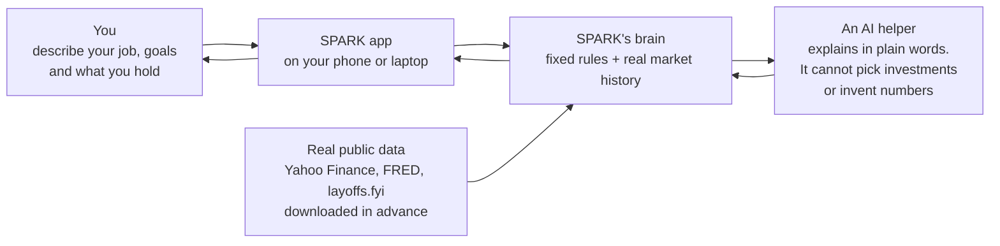
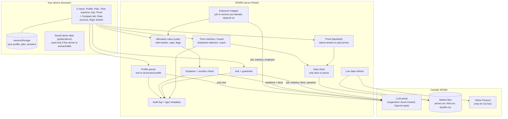
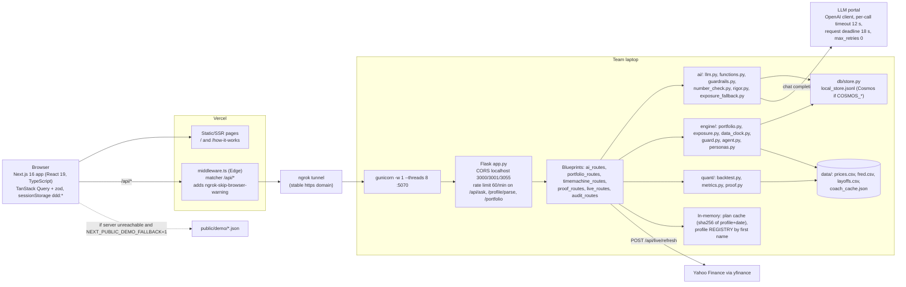

# SPARK architecture, at three levels of detail

Pick the level that fits the audience. All diagrams are Mermaid (they render on GitHub); the same content is drawn in the app at
`/how-it-works`. Accurate to the code on branch `faraaz`, 2026-10-23. Data handling: see [DATA-FLOW.md](DATA-FLOW.md).
Microsoft and Azure: see [MICROSOFT-AZURE.md](MICROSOFT-AZURE.md).

## Level 1: for anyone (one minute)

You tell SPARK about your life. SPARK's own rules decide how to split $100,000 so your savings don't lean on the same industry as your
paycheck. An AI only explains the result in plain words. Real past market prices let you replay 2022 and test the plan.

Three promises: (1) **code decides, AI explains**; (2) **every number the AI writes is checked** against facts our code produced;
(3) **nothing after the simulation date is visible** to the app or the AI (the data clock).

## Level 2: the parts (product and team)

Trust controls: guardrails (look-ahead, prompt-injection and distress questions are refused in code before the LLM), the data clock,
the number check (reject and regenerate, else a deterministic template), fenced untrusted text, audit log, and the "rigor" metadata shown
in the app.

## Level 3: technical

### Endpoints

| Method and path | Blueprint / module | LLM? | Notes |
|---|---|---|---|
| `POST /api/profile/parse` | `ai_routes` -> `ai/functions.parse_profile` | yes | fenced text, JSON mode, pydantic validation, up to 2 retries, code adds contradiction flags |
| `POST /api/portfolio` | `portfolio_routes` -> `ai.map_exposure`, `engine/portfolio.build`, `ai.explain` | yes (exposure + explain) | registers profile in REGISTRY; cached by sha256(profile + date); `X-Cache` header |
| `POST /api/compare` | `portfolio_routes` | yes (exposure) | one build per profile, cached |
| `GET /api/replay` | `timemachine_routes` -> `engine/guard.replay` | optional | coach text via LLM only if `REPLAY_LLM=1` or `?llm=1`; else `coach_cache.json` or template; 404 if profile not remembered |
| `POST /api/ask` | `ai_routes` -> `ai/functions.answer` | yes | `guardrails.pre_filter` first (distress, injection, future); number check; audit |
| `POST /api/proof`, `GET /api/proof/script` | `proof_routes` -> `quant/proof` | **no** | backtest on prices up to the day before the sim date; ships source, sha256 and a standalone script |
| `POST /api/agent/step` | `timemachine_routes` -> `engine/agent` | no | Autopilot: whitelist, caps, kill switch |
| `GET /api/audit`, `GET /api/rigor/summary` | `audit_routes` | no | reads the audit store; **no authentication** |
| `GET /api/live/status`, `/live/quotes`, `POST /api/live/refresh`, `GET /api/data/sources` | `live_routes` | no | refresh = yfinance download, atomic write of `prices.csv`, 60 s cooldown |
| `GET /api/health` | `app.py` | no | `{ok, mocks}`; `USE_MOCKS=1` serves `backend/mocks/*.json` |

### Environment variables (names only)

`USE_MOCKS`, `FLASK_PORT`, `RATE_LIMIT_PER_MIN`, `REPLAY_LLM`; LLM: `LLM_BASE_URL`, `LLM_API_KEY`, `LLM_MODEL`, `LLM_FAST_MODEL`,
`LLM_API_VERSION`, `LLM_AUTH_HEADER`, `LLM_MAX_TOKENS`, `LLM_TIMEOUT_S`, `LLM_DEADLINE_S` (or the `AZURE_OPENAI_*` equivalents);
store: `COSMOS_ENDPOINT`, `COSMOS_KEY`, `COSMOS_DATABASE`; frontend: `NEXT_PUBLIC_API_URL`, `NEXT_PUBLIC_DEMO_FALLBACK`.

### Fallbacks (the demo must survive)

LLM down or unconfigured -> HTTP 502/504 `{"error", "fallback": true}`; exposure falls back to a keyword map; explanations fall back to a
deterministic template; server unreachable -> frontend loads `public/demo/*.json` and says "Offline demo data"; `USE_MOCKS=1` serves fixtures.
